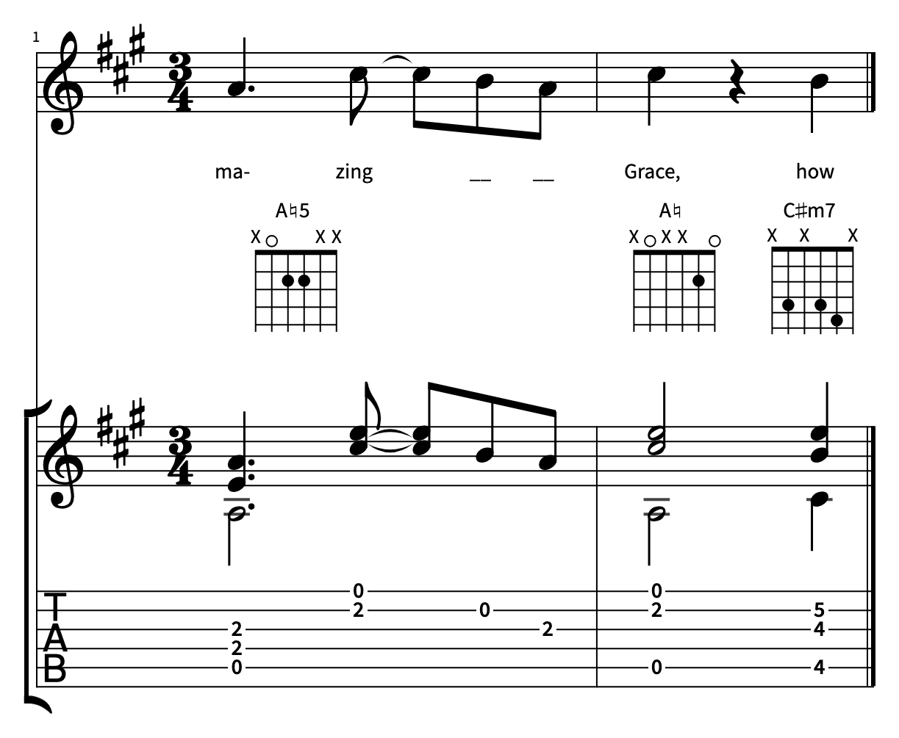
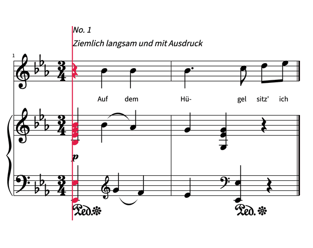
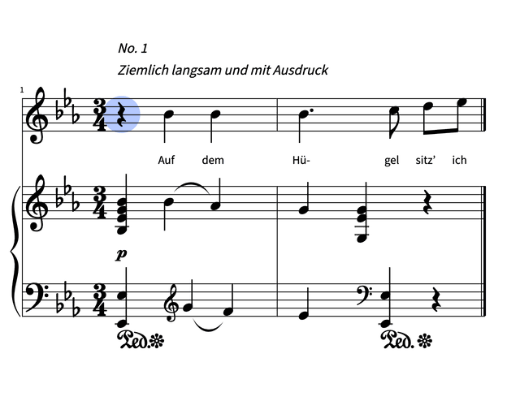
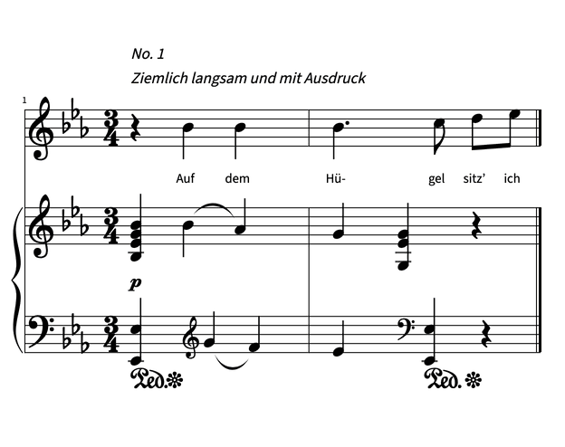
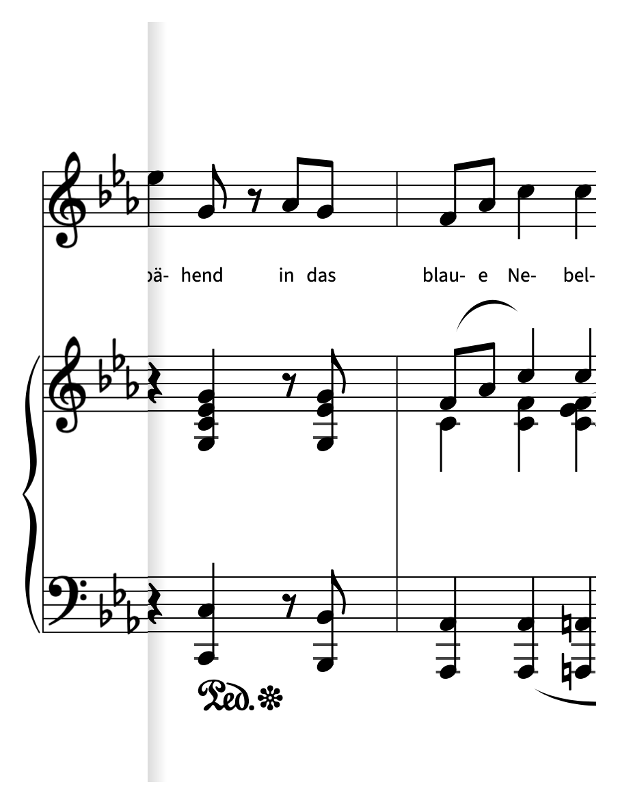
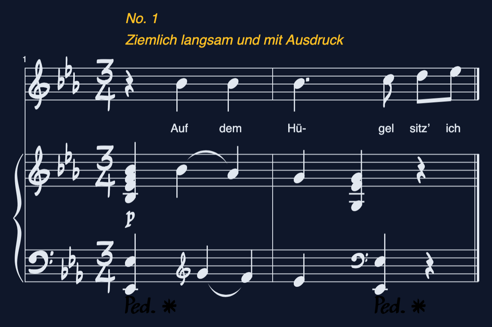
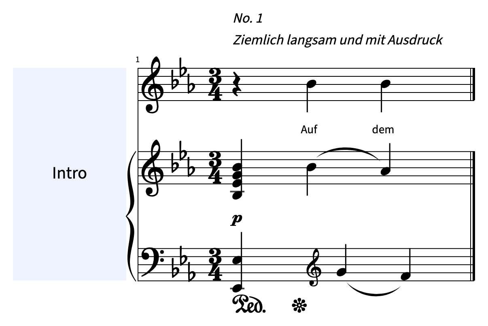

# vexml

Render sheet music in the browser. **Try it at https://vexml.dev.**

```sh
npm install @stringsync/vexml
```

```ts
import { render } from '@stringsync/vexml';

const score = await render(musicXML, document.getElementById('score'));
```

Building with a coding agent? Add the vexml skill, then ask your agent for what you want:

```sh
npx skills add stringsync/vexml@vexml
```

The skill is the full guide, also readable at [`skills/vexml/SKILL.md`](skills/vexml/SKILL.md).

## Features

- [Notation and tablature](#notation-and-tablature)
- [Playback cursor](#playback-cursor)
- [Pointer events](#pointer-events)
- [Editing](#editing)
- [Sticky clef and key](#sticky-clef-and-key)
- [Fonts and colors](#fonts-and-colors)
- [Gap measures](#gap-measures)
- [Layouts and printing](#layouts-and-printing)
- [Canvas layers](#canvas-layers)
- [Snapshots](#snapshots)

### Notation and tablature



Standard notation, guitar tab, lyrics, chord symbols and diagrams, repeats and voltas. The
score scales to fit its container.

vexml engraves an [mdom](https://www.npmjs.com/package/@stringsync/mdom) document, so it
reads whatever mdom does: MusicXML text (`.musicxml`, `.xml`), a compressed `.mxl` Blob, or
a document mdom parsed from another format, such as Guitar Pro (`.gp`).

```ts
import { GuitarProParser } from '@stringsync/mdom';

const document = await new GuitarProParser().parseFromBlob(gpFile);
await render(document, element);
```

### Playback cursor



A cursor walks the timeline with repeats and voltas unrolled, reporting which notes start,
sustain and stop, so you can drive audio or light up notes.

```ts
const cursor = score.createCursor();
cursor.sync(score.createPlayhead());
cursor.events.on('change', (e) => e.highlighted.forEach((note) => note.color.on('red')));
cursor.seekMs(audio.currentTime * 1000);
```

### Pointer events



Every note, measure and fret is hit-testable. Events report what's under the pointer, and
notes can be colored or haloed.

```ts
import { Note } from '@stringsync/vexml';

score.events.on('click', (e) => {
  if (e.target instanceof Note) e.target.halo.on('rgba(41, 98, 255, 0.35)');
});
```

### Editing



`EditingSession` adds keyboard and pointer selection with undo and redo over an editable
document.

```ts
const editor = new EditingSession(document);
score.createEditingController(editor);
editor.setPitch({ step: 'G', octave: 5 });
```

### Sticky clef and key



A single scrolling line keeps its clefs and key signatures pinned at the left edge,
switching when a change scrolls under them.

```ts
await render(musicXML, element, {
  layout: { type: 'panoramic', stickySignatures: true },
  width: 420,
});
```

### Fonts and colors



Swap the music font (Bravura by default) and the text font, and recolor notation, text and
background for any theme.

```ts
await render(musicXML, element, {
  backgroundColor: '#0f172a',
  fonts: {
    notation: { family: 'Petaluma', url: '/fonts/petaluma.woff2', color: '#e2e8f0' },
    text: { family: 'Inter', url: '/fonts/inter.woff2', color: '#fbbf24' },
  },
});
```

A large font can be split across files by `unicode-range` (`faces` in place of `url`): vexml
fetches only the files a score's glyphs need, and waits for them before it draws. The
default Bravura is split so: most scores fetch only its common glyphs
(`@stringsync/vexml/fonts/bravura-common.woff2`, about 33 kB, on `BRAVURA_COMMON_RANGE`),
and a rare glyph fetches the whole face (`@stringsync/vexml/fonts/bravura.woff2`, on
`BRAVURA_REST_RANGE`). Preload the common file to start it with the page.

### Gap measures



Insert empty, labeled measures that last a fixed time, to line the score up with a video or
recording that pauses between passages.

```ts
await render(musicXML, element, {
  gaps: [{ beforeMeasureIndex: 0, durationMs: 8000, label: 'Intro' }],
});
```

### Layouts and printing

Fit the container, scroll one long line, or lay the score out on fixed-size pages and
export each page as a PNG for print.

```ts
const score = await render(musicXML, element, {
  layout: { type: 'paged', pageWidth: 816, pageHeight: 1056, margin: 48 },
});
const pngs = await Promise.all(score.getPages().map((page) => page.toBlob()));
```

### Canvas layers

Draw your own annotations in front of or behind the engraving on a 2D canvas that stays
aligned with the score.

```ts
const layer = score.addLayer('content', -1);
layer.ctx.fillRect(50, 50, 100, 80);
```

### Snapshots

Cache a rendered score as JSON and render it again roughly 10x faster, make snapshots on a
server, or paint one with an 8 KB script before your app loads.

```ts
const snapshot = score.snapshot();
await render(snapshot, element);
```

### Progressive rendering

Show the first screen of a long score at once and draw the rest while the page is idle.
The score's timeline and measures are complete from the start; the systems not yet drawn
are a forecast until `draw` events name them as they land.

```ts
const score = await render(musicXML, element, { progressive: true });
score.events.on('draw', (e) => console.log('drawn systems', e.systems));
await score.whenComplete();
```

## Development

Needs [bun](https://bun.sh) and [docker](https://docs.docker.com/desktop/). The library is
[`packages/vexml`](packages/vexml); the rest of the repo builds, tests and demos it.

```sh
./bin/vex dev                              # run the playground
./bin/vex render --input song.musicxml     # render a MusicXML file to a PNG
```

`./bin/vex readme` re-records this README's images and GIFs (it needs ImageMagick).

The optional [complete-score audit](benchmarks/complete-scores/README.md) records
render timings and visual lint findings without adding to the main test suite.
Its scores are available in the playground's example picker under **Complete score**.
